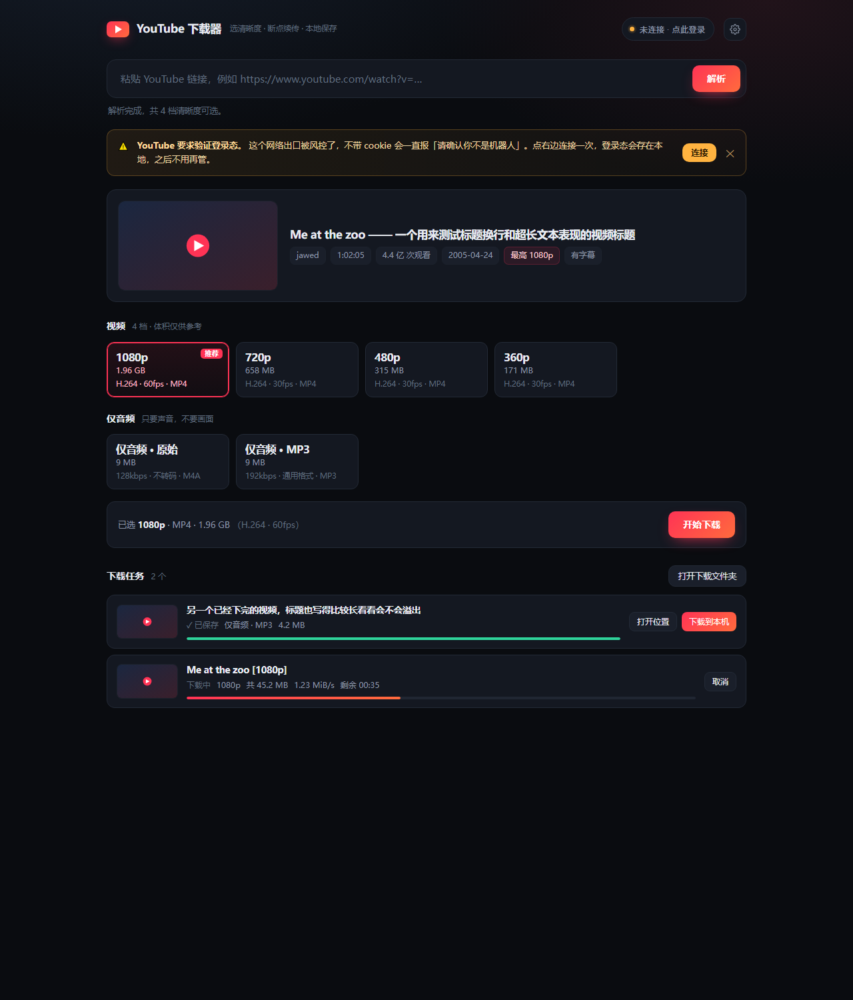

# YouTube 视频下载器

粘链接 → 选清晰度 → 下载到本地。纯本地运行，不经过任何第三方服务器。



> 这是一个**需要本地后端**的应用（Python + yt-dlp），所以只能在自己电脑上跑，
> 没法挂在 GitHub Pages 那种纯静态托管上。仓库里的 [`docs/`](docs/) 是项目主页。

## 安装

需要 **Python 3.9+**。另外两件事必须做，否则高画质（音视频分离的档位）会合并失败：

1. **装依赖**
   ```bash
   pip install -r requirements.txt
   ```
2. **放好 ffmpeg**：把 `ffmpeg.exe` 放到程序目录的 `bin/` 下（Windows），或保证 `ffmpeg` 在 PATH 里。

想下 1080p 以上时，yt-dlp 还需要一个 JS 运行时；装了 Node.js 的话程序会自动找到。

## 启动

双击 `start.bat`，浏览器会自动打开 <http://127.0.0.1:8799/>。

关掉那个黑窗口就停止服务。已经在运行时再双击，会直接帮你把界面打开，不会起第二个实例。

第一次用先在右上角设置里填好**代理地址**（拉 YouTube 需要能出海的网络），留空表示直连。

## 为什么第一次要「连接 YouTube」

YouTube 现在对机房 / 代理出口的 IP 有风控，不给登录态就直接返回：

> Sign in to confirm you're not a bot

这时候点右上角的「未连接 · 点此登录」，会弹出一个独立的浏览器窗口 —— 在里面登录你的 Google 账号，程序检测到登录成功后自动抓取 cookie 并关窗。

几点说明：

- 这个窗口用的是**独立的浏览器配置**（`data/edge-profile`），跟你日常用的 Edge 互不干扰，也不会动你的书签和密码。
- 登录态存在 `data/cookies.txt`，只有本机这个程序会读。不想要了就在设置里点「断开」。
- **只需登录一次**。之后解析和下载都会自动带上，直到 cookie 过期（通常几周）。过期了再点一次就行。

为什么不直接用 `--cookies-from-browser`：新版 Edge/Chrome 的 cookie 库被浏览器独占加锁，而且用的是 App-Bound 加密，外部程序根本解不开。这里走的是浏览器调试协议，拿的是它自己解密后的明文，绕开了这两个限制。

## 清晰度怎么选

每个分辨率一档，卡片上标的是「体积 · 编码 · 帧率 · 容器」：

- **H.264**（mp4）—— 兼容性最好，什么播放器、什么剪辑软件都认。1080p 及以下优先给这个。
- **VP9 / AV1** —— 同样画质下体积更小，4K 只有这两种。会封装成 mkv。
- 「推荐」标在 ≤1080p 里最高的一档上。

体积是算出来的：视频流 + 音频流。标「约」的是按码率估的，实际可能有出入。

底下还有「仅音频」两组：原始 M4A（不转码，最快）和 MP3 192k（通用格式）。

## 文件存在哪

默认在程序目录的 `downloads/`，可以在设置里改成任意路径。

文件名形如 `视频标题 [视频ID][1080p].mp4`，带分辨率方便区分同一视频的不同档位。

## 常见问题

**解析卡住 / 一直转圈**
多半是代理不通。到设置里确认代理地址和代理软件状态。

**报了一堆看不懂的 extraction 错误**
YouTube 改版很勤，先升级 yt-dlp 再说：`pip install -U yt-dlp`。九成的解析报错都是版本旧了。

**报「YouTube 要求登录验证」**
就是上面那条，点右上角连接一次。

**下载完没有声音 / 打不开**
检查 ffmpeg 在不在。界面顶部如果提示没找到 ffmpeg，高画质（音视频分离的）会合并失败。

**能不能下播放列表**
目前只处理链接里的第一个视频，会提示列表总数。批量下载没做。

## 目录结构

```
ytdl/
├─ app.py                 Flask 服务（127.0.0.1:8799）
├─ start.bat              双击启动
├─ core/
│  ├─ config.py           设置与路径探测
│  ├─ extract.py          格式列表 → 清晰度档位（纯函数，可单测）
│  ├─ probe.py            调 yt-dlp 解析
│  ├─ downloader.py       下载、进度解析、取消
│  ├─ jobs.py             任务状态机
│  ├─ auth.py             登录态管理
│  └─ edge_login.mjs      登录向导（CDP 导出明文 cookie）
├─ static/index.html      界面（单文件，无框架）
├─ tests/                 自检脚本
└─ downloads/             成品
```

## 自检

```bash
python tests/test_extract.py   # 格式归并逻辑
python tests/check_ui.py       # 界面静态检查（语法 / DOM id / 接口对齐）
```
